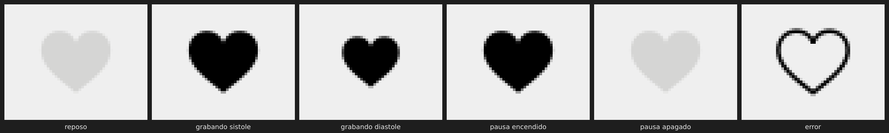

# Entrega — Lorito Aldhiro 0.14.005

*Lorito Aldhiro. Powered by Carola Records Aldhira Capture CRAC*

| Artefacto | SHA-256 |
|---|---|
| [`lorito_aldhiro_v0_14_005_golden_0.14.tar.gz`](lorito_aldhiro_v0_14_005_golden_0.14.tar.gz) — árbol completo 0.14.005 (fuentes, pruebas, herramientas, documentación, legado) | `17db7d15afe701f45ee683a89eb50341aabe9164fd9ad51ed8f716e636de6d29` |
| [`lorito_aldhiro_v0_14_005_runtime.tar.gz`](lorito_aldhiro_v0_14_005_runtime.tar.gz) — paquete de producción 0.14.005 | `54910ee8d44cb6ee71e72c99557e550e7eec21e823fe79ae0dbaf4fd807d9a92` |
| [`lorito_aldhiro_v0_14_004_golden_0.14.tar.gz`](lorito_aldhiro_v0_14_004_golden_0.14.tar.gz) — árbol completo 0.14.004 (fuentes, pruebas, herramientas, documentación, legado) | `0f5b219a1d45eaf8f486f293360bf499509debfbc4bbfb2e11a8f3096868e8c0` |
| [`lorito_aldhiro_v0_14_004_runtime.tar.gz`](lorito_aldhiro_v0_14_004_runtime.tar.gz) — paquete de producción 0.14.004 | `a0e9b6d20481480740fb858bffe49e60aaea58f45847d738f4cbb4c4f07d2de8` |
| [`lorito_aldhiro_v0_14_003_golden_0.14.tar.gz`](lorito_aldhiro_v0_14_003_golden_0.14.tar.gz) — árbol completo 0.14.003 (fuentes, pruebas, herramientas, documentación, legado) | `203d988a5923e3ed9146a087397d6fe5608e6afcbbb9a63921a3ceb62427af12` |
| [`lorito_aldhiro_v0_14_003_runtime.tar.gz`](lorito_aldhiro_v0_14_003_runtime.tar.gz) — paquete de producción 0.14.003 | `fbc05671f9c64ca743461c11bff968db541bad71a290f2d63270e2312a7f11c9` |
| [`lorito_aldhiro_v0_14_002_golden_0.14.tar.gz`](lorito_aldhiro_v0_14_002_golden_0.14.tar.gz) — árbol completo 0.14.002 (fuentes, pruebas, herramientas, documentación, legado) | `fff18cfec6e380e5e72cc25c765e21b1b9c169ad7866dd017f38ddd462c7f5ed` |
| [`lorito_aldhiro_v0_14_002_runtime.tar.gz`](lorito_aldhiro_v0_14_002_runtime.tar.gz) — paquete de producción 0.14.002 | `f0d43146d0dcdecd2a66551e036f5838a3936ed22349109c95683714d392dd9b` |
| [`lorito_aldhiro_v0_14_001_golden_0.14.tar.gz`](lorito_aldhiro_v0_14_001_golden_0.14.tar.gz) — árbol completo (fuentes, pruebas, herramientas, documentación, legado) | `b569e68d90ce7aad2062d75fa0ba92ff6019cb5c3ef465c50a371feef9c0bbec` |
| [`lorito_aldhiro_v0_14_001_runtime.tar.gz`](lorito_aldhiro_v0_14_001_runtime.tar.gz) — paquete de producción (solo lo que la aplicación necesita para arrancar) | `88767d403704addb30b406a665bdc1af2207da9cabb6f2787ea9afb390934d25` |

La versión sube a **0.14** con la Orden LA-GOLDEN-CORE-020 (modernización integral del núcleo). La 0.13 quedó cerrada en 0.13.009: ver [`ENTREGA_LORITO_ALDHIRO_0_13.md`](ENTREGA_LORITO_ALDHIRO_0_13.md).

## 0.14.005 — Corazón del Lorito

Cumple la Orden de Ingeniería "Corazón del Lorito" v1.0: un reloj maestro monotónico que da vida al corazón del LCD.

### Cómo se ve



| Estado de la captura | Corazón del LCD |
|---|---|
| En reposo, armando o finalizada | atenuado |
| Grabando | late: un latido por segundo de tiempo grabado, a tamaño completo en el golpe y al 82 % entre golpes |
| En pausa | parpadea al ritmo del reloj maestro de 480 ms, en fase con carretes y paneles |
| Error | solo el contorno, sin relleno: no finge estar vivo |

### Qué hay detrás

- **Motor `CorazonEngine`:**
  - mide con el reloj monotónico del sistema, nunca con la hora del equipo; cambiar la hora no mueve la duración;
  - las pausas no cuentan;
  - cada latido tiene un plazo absoluto, así que no acumula deriva.
- **Una sola autoridad:** el motor de captura. El corazón la sigue y no late hasta que la captura se confirma; si el stream no abre, pasa a error sin haber latido.
- **Independencia de la pantalla:** la pantalla solo lee la última foto del corazón. Un repintado lento no puede frenar ni alterar la captura.
- **Ritmo configurable:** 1 latido por segundo por defecto, ajustable entre 250 ms y 10 s.

### Banco

Medido en este contenedor (4 CPU), no en tu equipo.

| | En reposo | Con la CPU ocupada (4 hilos) |
|---|---|---|
| Diferencia del tiempo grabado frente a un reloj de referencia, en ~54 s | −1,8 ms (error de medición ±6 ms) | −31 ms (error de medición ±65 ms) |
| Latidos / esperados | 54 / 54 | 54 / 54 |
| Retraso de un latido p50 / máx. | 0,3 / 2,2 ms | 5,5 / 54 ms |
| CPU del corazón | 0,03 % | 0,03 % |

- **50 h simuladas:** tiempo exacto al nanosegundo y memoria estable.
- **Corrida real:** no se hizo una de 50 h.
- **Umbral:** ninguno se declara aprobado. Lo fijas tú con el banco en tu equipo:

  ```
  python tools/corazon/bench_corazon.py --seconds 600 --load 4 --json banco.json
  ```

### Pruebas

- **Suite completa:** 1190 pruebas OK (106 omitidas), con 0 ResourceWarning.
- **Qt real:** 386 pruebas, en 3 corridas OK.
- **Nuevas:** 19, de T-01 a T-10 más el icono.
- **Tarball:** verificado contra su manifiesto, con la suite corrida sobre el árbol extraído.
- **Paquete de producción:** reproducible.
- **Escáner de referencias:** 0 violaciones.

Detalle: `CORAZON_DEL_LORITO.md` (nota técnica e investigación), `gaps/GAP-097.md` (trazabilidad de la orden) y `saneamiento_0_14_005/`.

## 0.14.004 — Tus fallos: exportación, overlays, parpadeo, DSP, bobinado y LCD

### Lo que se corrigió

- **Exportación imposible y botones muertos.**
  - **Causa:** LORITO EXPORTADOR tomaba prestados los selectores de códec y profundidad de la ventana y, al cerrarse, no los devolvía; Qt los destruía con el diálogo.
  - **Efecto:** desde ese momento cada botón que los consultaba fallaba. Ese era el "Internal C++ object already deleted" de tus trazas.
  - **Arreglo:** ahora los devuelve al cerrarse, por cualquier vía (INICIAR, ABORTAR o Esc).
- **"Stream muerto (53317.7 s)".** REC podía arrancar mientras la sesión anterior aún se cerraba. El vigilante viejo leía un contador puesto a cero y calculaba el tiempo "sin callbacks" desde el arranque del equipo. Ahora REC espera a que esa sesión termine.
- **Primer SIPA:** muestra "SIPActiV" y entra en el modo de espera completo.
- **"VaccUm TP":** se ve fijo mientras se vacía el búfer.
- **Parpadeo:** un solo reloj de 480 ms marca la fase del LCD, los paneles de log y duración y la PC. La pausa manual ahora parpadea al mismo ritmo.
- **DSP que no se oían.**
  - **Reproducción:** ahora suena con la cadena DSP, como en CRAC. Muscle EQ Samir o cualquier DSP se oye al activarlo.
  - **Monitor de captura:** sigue sin DSP, igual que en CRAC.
- **Reglas de DSP:**
  - **PREVI:** son excluyentes con los demás procesadores; EQ/BIAS es el único que convive con ellos. Un rechazo muestra el motivo y Fnc No Disp.
  - **Al detener una captura:** se apaga todo menos EQ/BIAS, que conmuta a NORMAL.
  - **Leyenda "DSP":** la encienden solo los DSP sin leyenda propia (Versión O Tron y HX Pro).
- **Overlays:** CristhPrevi, LuchiPrevi, LoliPrevi y VoT AA-MO. Para los otros modos de O Tron: "VoT Barril" y "VoT Sifón".
- **Controles inhibidos:** un clic sobre un botón o scrub deshabilitado muestra Fnc No Disp.
- **Botón fantasma:** el selector diminuto de profundidad de bits que aparecía en la esquina superior izquierda ya no se ve; solo vive dentro de LORITO EXPORTADOR.
- **FF/REW con sonido:**
  - se oye la cinta acelerada a la velocidad real del motor (×8 a ×32), al derecho al avanzar y en reversa al rebobinar;
  - suena a −6 dB, con fundidos;
  - si no hay salida de audio, sigue mudo.
- **Columna derecha del LCD:** usaba letra más chica que la izquierda en celdas más angostas. Ahora las dos columnas miden lo mismo y usan la misma letra. Capturas en [`capturas_0_14_004/`](capturas_0_14_004/).

### Pruebas

- **Suite completa:** 1171 pruebas OK (105 omitidas), con 0 ResourceWarning.
- **Qt real:** 367 pruebas, en 4 corridas OK.
- **Nuevas:** 38 pruebas para estos arreglos.
- **Pruebas viejas actualizadas:** las que comprobaban el comportamiento que pediste cambiar.
- **Tarball:** verificado contra su manifiesto.
- **Paquete de producción:** reproducible.
- **Escáner de referencias:** 0 violaciones.

### Pendiente

- **Desbordamiento de tu primera traza:** no lo reproduje (el búfer llega como mucho al 11 %). Tu log muestra saltos de hasta 750 ms, lo que apunta a carga del equipo. Hay que verlo con tu hardware.
- **Aviso de Wayland:** el de los menús desplegables, es cosmético y quedó sin tocar.

Detalle: `gaps/GAP-096.md` y `saneamiento_0_14_004/TEST_REPORT_0.14.004.md`.

## 0.14.003 — El pre-roll entra en la grabación

### Lo que pediste

"El pre-roll debe entrar en la grabación." Ahora cada grabación empieza con los segundos previos a REC (hasta 15 s), pegados al audio en vivo sin hueco ni solape.

### Lo que se encontró

En 0.14.002 te dije que el pre-roll se rechazaba por la espera de 200 ms. Al corregirlo vi que era peor: **nunca entraba**. El micrófono/línea solo se abría al pulsar REC, así que el buffer de pre-roll nunca recibía audio. Además, se vaciaba dos veces justo antes de grabar. Medido con el camino de REC de 0.14.002: 0 frames de pre-roll en la primera grabación y en la segunda.

### Cómo funciona ahora

- **Escucha en espera:** con Lorito en pantalla, la entrada queda escuchando en espera y solo llena el pre-roll. No graba nada en disco, ni mueve medidores, ni monitoriza.
- **Al pulsar REC:** la grabación usa ese mismo stream sin reabrirlo. El pre-roll se escribe primero y el audio en vivo sigue a continuación, como una sola cinta.
- **Siempre lista:** la escucha vuelve a abrirse después de cada STOP y sigue a la frecuencia elegida en MUESTRA. Si REC pide una frecuencia distinta, graba como antes, sin pre-roll.
- **Cuentas cerradas:** el pre-roll cuenta como audio recibido, así que la integridad y la deriva no dan falsas alarmas. El log anota "Pre-roll: N s antepuestos a la grabación".
- **A tener en cuenta:** con Lorito abierto, la entrada de audio queda ocupada. Otra aplicación que la pida en exclusiva no podrá usarla.

### Pruebas

- **Suite completa:** 1134 pruebas OK (96 omitidas), con 0 ResourceWarning.
- **Qt real:** 335 pruebas, en 3 corridas OK. En la verificación del tarball, 1 corrida tuvo la falla de tiempo de TAU ya anotada en GAP-094 (previa, aparece en 0.14.001 igual).
- **Nuevas:** 9 pruebas (`tests/test_preroll_standby.py`). Usan un stream que numera cada muestra y comprueban que el archivo sea una sola rampa continua del pre-roll al audio en vivo, con la contabilidad cerrada.
- **Tarball:** verificado contra su manifiesto, con la suite completa corrida sobre lo extraído.
- **Paquete de producción:** reproducible.
- **Escáner de referencias:** 0 violaciones.

### Pendiente

- Probarlo con equipo de audio real. Las pruebas usan un stream simulado, pero el camino (callback, ring, drenado, disco) es el real.
- El pre-roll dura 15 s fijos; no hay ajuste en el menú.

Detalle: `gaps/GAP-095.md` y `saneamiento_0_14_003/TEST_REPORT_0.14.003.md`.

## 0.14.002 — Interfaz desacoplada de los motores; estado de sesión con un solo dueño

Continúa la Orden LA-GOLDEN-CORE-020 con lo que había quedado pendiente en 0.14.001.

### Lo que pediste

- **Interfaz desacoplada de los motores.** La interfaz ya no importa los motores: los pide a una capa de servicios (`backend/services`). Cada servicio tiene un contrato con exactamente lo que la interfaz usa, y una prueba falla si la interfaz usa algo fuera del contrato o toca piezas privadas de un motor.
  - Aristas directas interfaz → motores: de 132 (en 16 módulos) a 4, todas en el parche de diagnóstico, que audita esas clases a propósito.
  - Piezas privadas de motores usadas por la interfaz: de 15 a 0.
  - Nombres importados sin uso en la interfaz: de 1.536 a 0.
- **Objetos globales retirados o con dueño único.** El estado global de sesión se retiró. El guardián de crash, los snapshots, el registro de clips, el forense de xruns y el nuevo vigilante de RAM se reciben de la raíz de composición (`build_app_services()`), no de variables globales.

### Lo que se encontró y se corrigió

- **Estado de sesión partido en dos (defecto real, desde la modularización).** El motor contaba frames y xruns en su objeto, y la interfaz leía otro objeto global que nadie actualizaba. Con audio real:
  - el snapshot periódico de sesión no se guardaba nunca;
  - aparecía un aviso falso de deriva ("LORITO VIO UNA DERIVA") en cada grabación;
  - la exportación comparaba 0 con 0 en su chequeo de integridad.

  Medido con 10 s grabados: antes −10000 ms de deriva y sin snapshot; ahora −0,2 ms y con snapshot.
- **Prioridad de tiempo real aplicada al hilo equivocado:** se retiró la llamada (el hilo de drenado ya fija la suya).
- **Dos guardas de SIPA muertas:** leían campos que ya no existen; se retiraron.
- **Eventos TAU:** se identificaban con `id()`, que Python reutiliza; ahora llevan un contador único.
- **Vigilante de RAM:** la memoria es del proceso, no de una ventana. Al mover el estado de sesión al motor quedaba uno por ventana y cada ventana repetía la limpieza de emergencia de memoria en el hilo de la interfaz. Ahora hay un solo vigilante por proceso.

### Decisión tuya pendiente: pre-roll

Al empezar a grabar, Lorito espera 200 ms antes de intentar meter el pre-roll. Para entonces ya hay audio en vivo en cola, y el pre-roll se rechaza casi siempre ("Pre-roll rechazado: ya hay audio en vivo encolado"). No se cambió, porque cambiarlo altera qué audio queda en el RAW. Detalle en `gaps/GAP-094.md` §4.

### Pruebas

- **Suite completa:** 1125 pruebas OK (96 omitidas: necesitan Qt real o hardware), con 0 ResourceWarning.
- **Qt real:** 326 pruebas, en 3 corridas: 2 limpias y 1 con una prueba de tiempo de TAU fuera de tolerancia. Esa prueba falla igual (1 de cada 6 corridas) en 0.14.001: es previa y queda anotada en GAP-094.
- **Nuevas:** 18 pruebas (`tests/test_core_servicios.py`): dueño del estado de sesión, contratos, capa de servicios, tokens TAU y vigilante de RAM.
- **Tarball:** verificado contra su manifiesto, con la suite completa corrida sobre lo extraído.
- **Paquete de producción:** reproducible (dos construcciones dan el mismo SHA-256).
- **Escáner de referencias:** 0 violaciones.

### Lo que queda pendiente

- Sesión larga con hardware de audio real y revisión en otra máquina. Por eso la certificación Golden completa sigue sin declararse.
- Dentro del núcleo, los objetos globales siguen existiendo en sus módulos; la interfaz solo los alcanza por la capa de servicios.
- `ACERCA` sigue en "Fnc No Disp" hasta que estén el logo y los créditos.

Informe completo: `saneamiento_0_14_002/TEST_REPORT_0.14.002.md`, `gaps/GAP-094.md` y `MODERNIZACION_NUCLEO_GOLDEN.md` §1 y §9.

## 0.14.001 — Núcleo autónomo; CRAC como referencia histórica

### Lo que pediste

- **CRAC como referencia histórica.** Ningún módulo, archivo, log, hilo, mensaje ni recurso de Lorito nombra a CRAC. La historia se conserva entera en `legado/procedencia/`:
  - las 1.418 referencias que había en 0.13.009, cada una con su texto original, archivo, línea y SHA-256;
  - el changelog de CRAC anterior a la bifurcación;
  - el catálogo VFD de CRAC y de qué línea salió cada overlay del LCD;
  - el código reemplazado.
- **La atribución, tal cual:** "Lorito Aldhiro. Powered by Carola Records Aldhira Capture CRAC". Vive en una sola constante del código. Aparece en el README, en el archivo histórico y en `python3 lorito_bootstrap.py --version`.
- **AECCT2, solo en Media Anim:** es el título de la computadora animada, en la constante `MEDIA_ANIM_COMPUTER_CAPTION`. Una prueba vigila que no aparezca en ningún otro lado: logs, rutas, configuración, metadatos, nombres.
- **Investigación en internet:** no hay registro público de CRAC ni de "Aldhira Capture"; es software interno de Carola Records. La investigación sí sirvió para la parte técnica de la orden (detalle y fuentes en `MODERNIZACION_NUCLEO_GOLDEN.md` §2).

### Lo que cambia para quien usa Lorito

| Antes | Ahora |
|---|---|
| Exportación `aecct2_<fecha>.wav` + `…_aldhira_spec_crac.txt` | `lorito_<fecha>.wav` + `…_lorito_spec.txt` |
| "Aldhira de Especificación de CRAC" / "C.R.A.C Tape Counter" | "Aldhira de Especificación de Lorito" / "Lorito Tape Counter" |
| Títulos "ADVERTENCIA CRAC", "CRAC Save", "CIERRE ABRUPTO DE CRAC"… | "ADVERTENCIA LORITO", "LORITO SAVE", "CIERRE ABRUPTO DE LORITO"… |
| Log interno `aecct2_internal.log` | `lorito_internal.log` (el viejo queda donde está) |

- **Migración al arrancar:** los archivos de control de una sesión anterior (latido y manifiesto de recuperación de crash) pasan solos a los nombres nuevos, con respaldo. Una sesión que se cortó con 0.13 se recupera igual con 0.14.
- **Lo que no se toca:** capturas RAW, temporales, exportaciones ya hechas y sus especificaciones.

### Lo que se encontró y se corrigió

- **Dependencia faltante:** `scipy` no figuraba en `requirements.txt`, aunque lo usan los DSP PREVI. En una instalación limpia no habrían funcionado.
- **Carga desde el monolito:** la física de cinta intentaba cargar un motor del monolito de CRAC y, al no hallarlo, seguía con la suya sin avisar. Se retiró ese intento. La salida es idéntica a 0.13.009 (verificado con una traza de 1.406 muestras).
- **Ciclo de imports oculto:** había uno entre el LCD y los paneles SVG, y se rompió.
- **Capas invertidas:** un módulo del núcleo importaba la interfaz y pasó a la capa de interfaz.
- **Prueba muerta:** la prueba de los 20 perfiles de Lucha Enloquecida nunca se ejecutaba, porque dependía del árbol de CRAC. Ahora se ejecuta contra una referencia propia.

### Lo que queda pendiente de la orden

- Desacoplar la interfaz de los internos de los motores, mediante contratos de servicio.
- Retirar los singletons globales.
- Hacer una sesión larga con hardware de audio real.

Por eso la orden queda **certificada en parcial**. Detalle en `MODERNIZACION_NUCLEO_GOLDEN.md` §1 y §9.

### Pruebas

- **Suite completa:** 1107 pruebas OK (96 omitidas: necesitan Qt real o hardware), con 0 ResourceWarning.
- **Qt real:** 308/308. Incluye el arranque desde el paquete de producción con una carpeta de usuario vacía.
- **Nuevas:** 41 pruebas de la orden (`tests/test_core_independencia.py`): escáner, alcance de AECCT2, atribución, archivo histórico, migración, arquitectura, regresión de transporte y paquete.
- **Tarball:** verificado contra su manifiesto, con la suite completa corrida sobre lo extraído.
- **Paquete de producción:** reproducible (dos construcciones dan el mismo SHA-256), sin legado ni historia, 0 referencias prohibidas.
